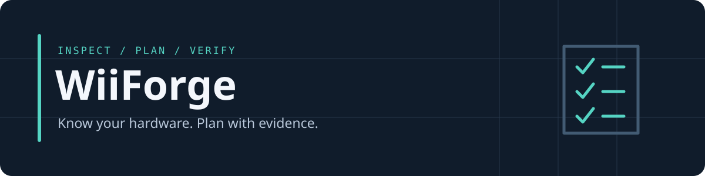

<p align="center">
  
</p>

<p align="center">
  <strong>Read-only Wii homebrew planning, built for people and their agents.</strong><br>
  Python 3.10+ · Zero runtime dependencies · MIT licensed · Planning MVP
</p>

<p align="center">
  <a href="#try-it-in-a-minute">Quickstart</a> ·
  <a href="docs/usage.md">Usage</a> ·
  <a href="#support-status">Support</a> ·
  <a href="docs/roadmap.md">Roadmap</a> ·
  <a href="CONTRIBUTING.md">Contribute</a>
</p>

---

WiiForge turns hardware observations into a checked, resumable **manual setup plan** centered on USB Loader GX. It keeps unknowns visible, separates historical observations from new test results, and gives any coding agent the same deterministic tools and safety rules.

> **Current scope:** read-only inspection and manual planning, plus controlled file preparation and opt-in disposable staging. Staging writes to OS temporary storage; its backing device is not verified. WiiForge does not install homebrew, download packages, format drives, repair filesystems or write to a console. Live hardware validation is still pending.

## Why WiiForge?

- **Evidence before instructions.** Unknown or conflicting console details block model-sensitive plans. An SD card cannot tell us which Wii you own.
- **Opinionated, adjustable defaults.** USB Loader GX is the starting point. Video settings are preserved; autoboot and GameCube support require separate review.
- **Resume with context.** Checkpoints are bound to the profile, observations and disk report. Changed inputs invalidate previous progress.
- **Bring your own agent.** A small Python CLI, readable JSON output and [AGENTS.md](AGENTS.md). No agent framework, account or service required.

## Start with your assistant

Open this repository in your coding assistant and paste:

> Read AGENTS.md and run the synthetic demo. Help me collect the console observations needed for a WiiForge plan, keeping unknowns explicit. Explain each blocker in plain language. Keep my reports outside the repository. Do not select a disk, install software, stage packages or change my Wii without discussing that specific step with me.

You can use any assistant that can run Python commands. It should first show you a plan and the evidence
still needed. WiiForge does not provide an automatic homebrew installation or an undo button for console changes.

## Try it in a minute

You need Git and Python 3.10+ already installed. These commands use a POSIX shell on macOS or Linux. No Wii, SD card, USB drive, package installation or elevated privileges needed.

```sh
git clone https://github.com/jcb79107/wiiforge.git
cd wiiforge
export PYTHONPATH="$PWD/src"
python3 -m wiiforge demo
```

The demo runs the real planner against **invented data**, showing an allowed manual plan, an unknown-model rejection and an empty resume state. It never inspects hardware or records a successful console test.

Selected output fields:

```json
{
  "demo": true,
  "manual_plan": {"status": "manual-review-only", "execution_supported": false},
  "unknown_model_plan": {"status": "blocked", "steps": []},
  "initial_state": {"completed": []}
}
```

Explore the commands or run the synthetic tests:

```sh
python3 -m wiiforge --help
python3 -m unittest discover -s tests -v
```

**Ready to gather real evidence?** Follow [the usage guide](docs/usage.md). Live inspection is macOS-only. Choose the physical disk yourself, keep reports outside the checkout, and leave unknown evidence unknown. Do not use demo data for a real console.

## How it works

```text
Read disk metadata + collect console observations
                       │
                       ▼
              Validate profile and evidence
                       │
          ┌────────────┴────────────┐
          ▼                         ▼
     Missing/conflicting       Manual review plan
     evidence → blocked             │
                                    ▼
                          Human-confirmed checkpoints
                          (no automatic execution)
```

| Command | What it does |
| --- | --- |
| `verify-package --manifest … --artifact … --model original` | Checks local package size/hash; optional experimental temporary staging; installation remains blocked ([provenance](packages/README.md)) |
| `prepare-plan` / `prepare` | Review exact destination writes, then approve the saved plan; no overwrites ([usage](docs/usage.md#controlled-file-preparation)) |
| `rehearse` | Copies built-in synthetic files into a private temporary host directory, verifies and removes them; accepts no package or destination |
| `demo` | Shows deterministic synthetic planning and rejection examples |
| `inspect --device diskN` | Reads macOS disk metadata; rejects ambiguous/internal targets |
| `plan --profile … --evidence … --inspection …` | Validates inputs and produces linked manual checkpoints |
| `resume --profile … --evidence … --inspection …` | Validates saved progress or records the next explicit acknowledgment |

JSON goes to stdout; errors go to stderr. Exit `0` means the requested operation succeeded, **not** that a console works. Exit `2` means blocked or invalid. Profiles use JSON syntax, a strict YAML 1.2 subset; arbitrary YAML is not supported.

## Support status

| Area | Implemented today | Validation / limit |
| --- | --- | --- |
| Original Wii, 4.3U | Manual planning reference | Historical setup evidence; this tool has no live installation validation |
| Other original-Wii menus/regions | Input recognized | Installation planning blocked |
| Family Edition | Model recognized | Installation planning blocked; no recipe |
| Wii mini | Model recognized | Installation planning blocked; no recipe |
| Wii U vWii | Model recognized | Installation planning blocked; no recipe |
| macOS storage inspection | Read-only `diskutil` adapter | Mocked tests only; real-device validation pending |
| Linux / Windows inspection | Not implemented | Fails closed; Linux can run the synthetic demo/tests |
| CRT / HD / regional video | Explicit profile fields; preserve by default | No tested display compatibility matrix |
| Wii / GameCube gameplay | Manual checkpoints | No gameplay compatibility claims |
| Package staging | Opt-in disposable host staging | Experimental; licensing/installation blocked; no destination accepted |
| Controlled file preparation | Explicit destination, reviewed plan and digest approval; no overwrites | Tested with isolated fixtures only; real-media validation pending |
| Formatting / console installation | Not implemented | Separate approval and model-specific validation required |

Storage checks conservatively require an external physical whole disk, persistent identifier, known capacity and a single MBR/FAT32 partition with 32 KiB clusters. Missing metadata blocks planning even if a drive might otherwise work. This is **not a filesystem integrity check or a guarantee of compatibility**.

## Safety is part of the interface

WiiForge never infers BootMii eligibility, installed cIOS or display capabilities from drive contents. It does not authorize changes, execute downloaded software, distribute games/keys/NAND/IOS files, or treat loader launch as proof that a game runs. Future destructive operations require separate explicit approval and fresh target checks.

Keep real reports, device identifiers and recovery material private. Checkpoints are user attestations, not signed evidence. Read the [evidence notes](docs/evidence.md), [agent rules](AGENTS.md) and [reporting guidance](SECURITY.md).

## What comes next

1. **Validate read-only inspection on real macOS hardware**, including reconnects and real diskutil metadata.
2. **Complete the upstream license review** before enabling distribution or installation. The pinned ZIP has passed host-side integrity and disposable-staging checks.
3. **Validate controlled preparation on disposable media** after specific approval. Completed files can resume by verification; forced termination during a file leaves a conflict requiring separate cleanup approval.

Each step has an explicit acceptance gate in the [roadmap](docs/roadmap.md). Wider console support follows evidence, not a release date.

## Contribute

Small, reproducible improvements are welcome: synthetic regression cases, clearer blocker explanations and documentation fixes. Start with [CONTRIBUTING.md](CONTRIBUTING.md). Hardware reports need explicit consent and redaction; never attach a raw recovery archive.

[Wii Hacks Guide](https://wii.hacks.guide/) is the authoritative procedural reference. [USB Loader GX](https://github.com/wiidev/usbloadergx) is the upstream loader. WiiForge is an independent project, not endorsed by either project or Nintendo.

[MIT license](LICENSE) · Third-party projects retain their own licenses.
